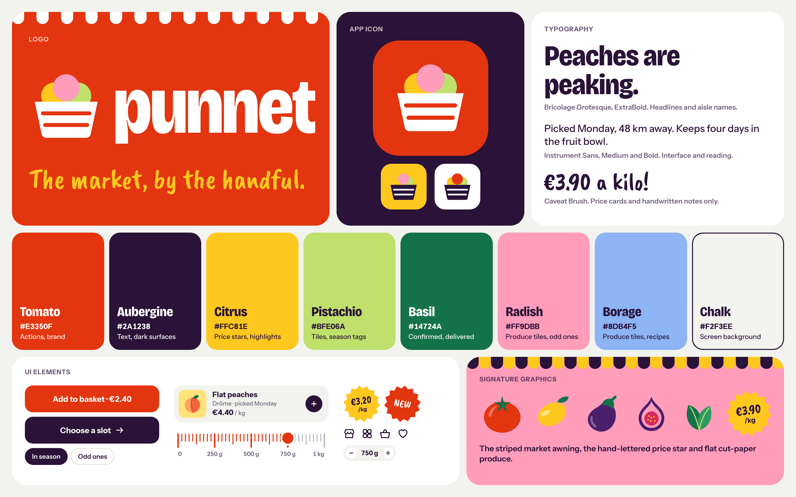
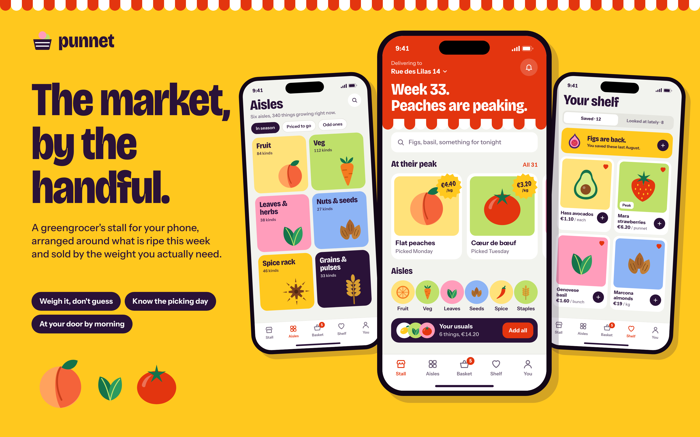
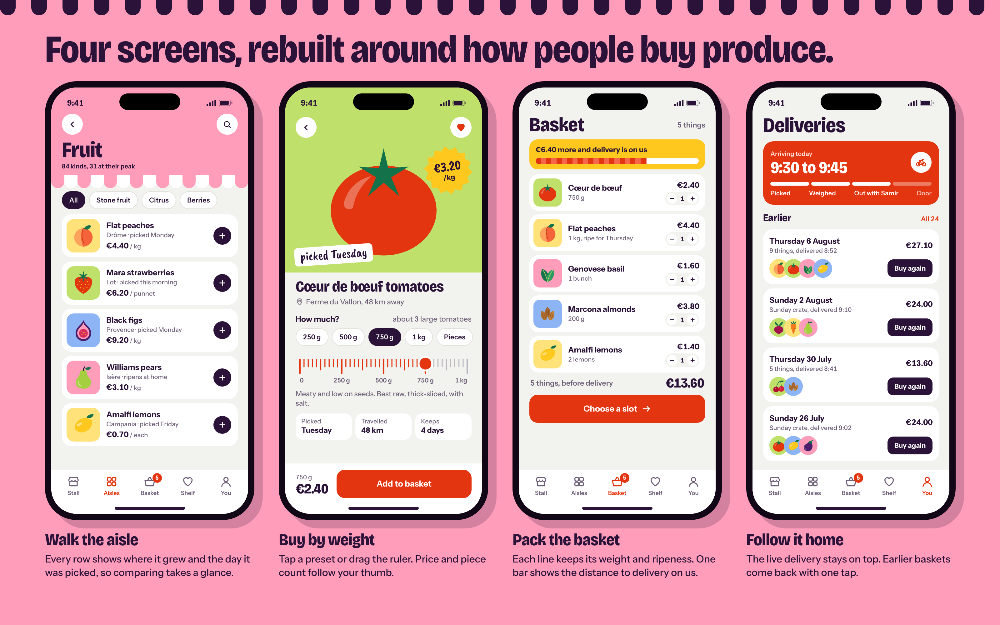
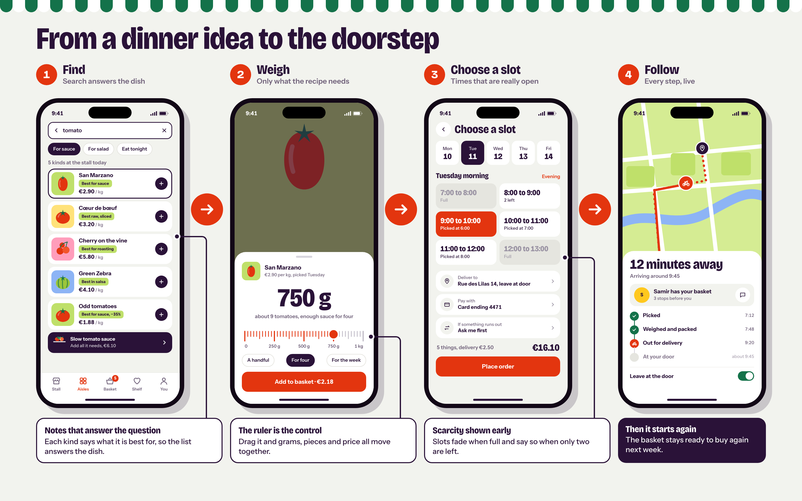
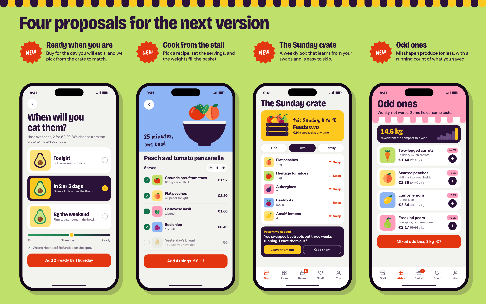
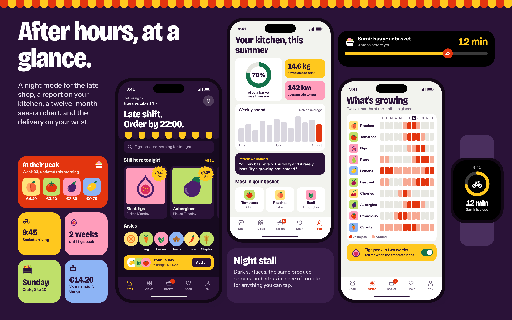

# Punnet

**The market, by the handful.**

> **Product concept.** Punnet is based on an earlier project. It is not published on the App Store or Google Play. All names, prices, places and figures in the screens are sample content.

## Introduction

A punnet is the small basket berries are sold in at a market stall. I picked the name because it describes how I wanted this app to feel: a small, considered amount of something good, rather than a trolley to fill.

Punnet is a fresh-produce app built around the habits of a greengrocer's stall. It opens on what is at its peak this week, sells everything by the weight you actually need, and tells you where each item grew and the day it was picked.

The look comes from the same place. A striped awning runs along the top of key screens, prices sit on hand-lettered stars like the ones stuck to market crates, and the produce is drawn as flat cut-paper shapes. Each food sits on a bright tile of its own, so the app stays colourful without relying on photography.

## What it does

- **Shows what's good right now.** The first screen leads with the week's peak produce and its prices.
- **Organises the stall into six aisles:** fruit, veg, leaves and herbs, nuts and seeds, spice rack, grains and pulses.
- **Sells by weight or by piece.** You tap a preset or drag a ruler, and the price and rough piece count update together.
- **Shows where food comes from.** Every item carries its region and picking day.
- **Delivers to a chosen slot.** You pick a time window and follow the basket to your door.
- **Keeps your favourites close.** Saved items and things you looked at recently share one shelf, and earlier baskets can be bought again with one tap.

## The problem

Buying produce on a phone loses most of what makes a market stall work. At a stall you can see what looks best today, ask how ripe something is and ask for a handful. In a typical grocery app, a peach is a small card in a grid, priced per kilo, with a plus button.

Three things go missing:

1. **Season.** A peach in August and a peach in February look identical on screen, so nothing tells you what is worth buying this week.
2. **Quantity.** Few people can picture 750 g of tomatoes. A price per kilo doesn't say what you will pay or how much you will end up with, so people guess and often buy too much.
3. **Confidence.** Origin, freshness and ripeness are how people judge produce, and they are usually missing or buried. The first real look at the fruit comes when it reaches the door.

The design below answers each one.

## Who it's for

- **Home cooks who shop weekly** and plan meals around what is good, instead of working through a fixed list.
- **One- and two-person households** that waste food when they can't buy small amounts.
- **Market lovers short on time** who care where their food comes from but rarely get to the Saturday stall.

## Main features (redesigned)

**The stall.** The home screen changes with the calendar. "Week 33. Peaches are peaking." sets the tone, followed by peak produce with price stars, the six aisles and a one-tap refill of your usuals.

**Aisles.** Large colour blocks replace a plain list of food groups. Each aisle opens on rows that show origin, picking day and price at a glance.

**Buy by weight.** The ruler is the main control. Presets cover common amounts, and a switch to pieces covers the things people prefer to count. A note above the presets translates grams into something you can picture: "about 3 large tomatoes".

**Basket.** Each line keeps its weight and any ripeness request. One bar shows how far you are from delivery on us.

**Deliveries.** The live delivery stays on top with a four-step progress bar. Earlier baskets sit underneath, ready to buy again.

**Your shelf.** Saved items and recent views live together, and the shelf speaks up when something you saved comes back into season.

### One journey, four steps

A cook decides to make tomato sauce, and the app carries them from that idea to a delivery at the door:

1. **Find.** Searching "tomato" returns five kinds, each with a note on what it suits best, so the list answers the dish as well as the word.
2. **Weigh.** Dragging the ruler to 750 g shows about nine tomatoes, enough sauce for four, and the price.
3. **Choose a slot.** Full windows fade before you tap them, and nearly full ones say how many are left.
4. **Follow.** A map, a courier name and a simple timeline show where the basket is.

## New proposed features

> **These are proposals.** They exist only as screen designs, and none of them is implemented.

| Proposal | What it does | Why it's worth testing |
|---|---|---|
| **Ready when you are** | You choose when you will eat an avocado or a peach: tonight, in two or three days, or by the weekend. Packers pick from the crate to match. | Ripeness is the biggest thing you give up when someone else chooses your fruit. |
| **Cook from the stall** | You choose a recipe and set the servings. Weights scale and go into the basket, and you can untick what you already have. | It turns "what's for dinner?" into a complete basket, in the right amounts. |
| **The Sunday crate** | A weekly box you can swap from or skip. "Pattern we noticed" suggests changes based on your swaps, such as leaving out beetroot. | A standing order that adapts is easier to keep than one you have to manage. |
| **Odd ones** | Misshapen produce at a lower price, with a running count of the food you have saved. | Cheaper produce for shoppers, and a sale for growers on crops that often go unsold. |

More proposals, alongside the night mode redrawn for this palette:

- **What's growing:** a twelve-month chart of the stall, with an alert when the first crate of a favourite arrives.
- **Your kitchen:** a seasonal report on how much of your basket was in season, weekly spend, food saved, and suggestions such as "You buy basil every Thursday and it rarely lasts."
- **Widgets and watch:** peak produce on the home screen, and a delivery countdown on the lock screen and wrist.
- **Night stall:** dark surfaces with the same produce colours, and citrus in place of tomato for anything you can tap.

## From prototype to product

Punnet is a design concept. This is what it would take to turn it into a real service.

| Area | In this concept | What a real product would need |
|---|---|---|
| Growers and range | A sample stall with six aisles | Signed growers in one region, and a daily routine for updating availability and picking days |
| Buying by weight | A ruler, presets and piece estimates | A clear promise on how close the packed weight will be, and how any difference is charged |
| Ripeness | Three choices tied to the day you will eat | Packing guidance for each fruit, and a refund policy people believe |
| Delivery | Time slots and live progress | A courier partner, starting with one pilot city |
| Odd ones and the crate | Screen designs | Grower agreements for misshapen stock, and a price test for the weekly box |
| Evidence | Design reasoning, not yet tested with shoppers | Usability sessions with weekly produce shoppers, then tracking repeat baskets, ripeness refunds and food saved |

## The concept and its value

Punnet treats a grocery app as a stall with a season instead of a catalogue with a search bar. That one decision shaped the rest: the home screen changes week by week, weight replaces quantity, and the picking day matters as much as the price.

- **For shoppers:** buying the right amount, knowing where it came from, and fewer disappointing deliveries.
- **For growers:** their region on every row, and a route to sale for produce that doesn't look perfect.
- **For the business:** a reason to come back every week, because the stall keeps changing, and steadier demand through the weekly crate.

### Palette

| Colour | HEX | Role |
|---|---|---|
| Tomato | `#E3350F` | Actions, brand |
| Aubergine | `#2A1238` | Text, dark surfaces |
| Citrus | `#FFC81E` | Price stars, highlights |
| Pistachio | `#BFE06A` | Produce tiles, season tags |
| Basil | `#14724A` | Confirmed, delivered |
| Radish | `#FF9DBB` | Produce tiles, odd ones |
| Borage | `#8DB4F5` | Produce tiles, recipes |
| Chalk | `#F2F3EE` | Screen background |

### Typography

Three Google Fonts: **Bricolage Grotesque** for headlines and aisle names, **Instrument Sans** for the interface and reading text, and **Caveat Brush** for price cards and handwritten notes.

---

Product concept by Ziad Abdellah.
